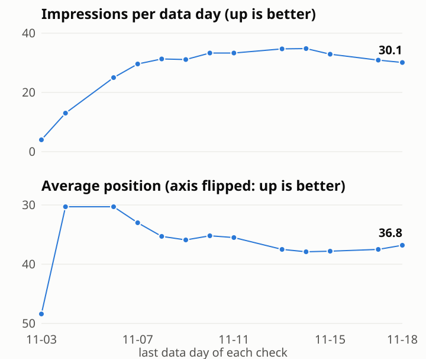

# Search Console — latest check

Checked 2026-11-26 by Claude in the owner's Chrome (domain property `sc-domain:hydrorigor.com`,
web search, "Last 28 days", all four metrics on). Data covers 2026-11-01 to 2026-11-24;
"Last update: 3 hours ago". Figures are copied from Search Console exactly.

## Totals

| Clicks | Impressions | CTR | Average position |
| --- | --- | --- | --- |
| 6 | 682 | 0.9% | 38 |

Search Console shows the average position as "38" with no decimal.

Previous check (2026-11-24, Nov 1–22): 6 clicks, 599 impressions, 1%, position 36.5.
Same weekday last week (Thursday 2026-11-19, Nov 1–17): 6 clicks, 526 impressions, 1.1%, position 37.5 (impressions per data day 30.9 → 28.4 ▼).
Baseline (2026-11-05, Nov 1–3): 0 clicks, 12 impressions, 0%, position 48.4.

Two new data days (Nov 23 and Nov 24): 34 impressions at position 35.3, then 49 at 58.0, the
best day since Nov 12 (54). The 28-day total rose ▲ (599 → 682) and, for the first time since
Nov 14, impressions per data day rose too ▲ (27.2 → 28.4). Average position slipped ▼ (36.5 → 38)
because most of Nov 24's impressions came from deep positions (58.0 for the day): newly published
system and equipment guides (drip, ebb and flow, what is hydroponics, air pump, water pumps) are
being shown for the first time, low in the results. CTR fell to 0.9% (6 / 682). Clicks stay at 6;
none since Nov 8.

| Day | Clicks | Impressions | CTR | Position |
| --- | --- | --- | --- | --- |
| Nov 24 | 0 | 49 | 0% | 58.0 |
| Nov 23 | 0 | 34 | 0% | 35.3 |
| Nov 22 | 0 | 19 | 0% | 32.3 |
| Nov 21 | 0 | 19 | 0% | 32.6 |
| Nov 20 | 0 | 10 | 0% | 42.3 |
| Nov 19 | 0 | 10 | 0% | 32.6 |
| Nov 18 | 0 | 15 | 0% | 12.6 |
| Nov 17 | 0 | 6 | 0% | 9.5 |
| Nov 16 | 0 | 27 | 0% | 38.1 |
| Nov 15 | 0 | 6 | 0% | 25.0 |
| Nov 14 | 0 | 36 | 0% | 43.9 |
| Nov 13 | 0 | 31 | 0% | 39.8 |
| Nov 12 | 0 | 54 | 0% | 49.5 |
| Nov 11 | 0 | 33 | 0% | 38.8 |

<!-- trend:start -->
## Trend

Generated by `node scripts/search-console-trend.mjs` from `log.md`. ▲ better, ▼ worse, ▬ no change
(for average position a lower number is better). While the site is younger than 28 days the window
keeps growing, so totals rise on their own; impressions per data day is the fairer rate to compare.

- **Since the previous check** (2026-11-24, data to 2026-11-22): impressions 599 → 682 ▲ +83 (+14%), clicks 6 → 6 ▬ ±0, CTR 1% → 0.9% ▼ −0.1 pt, position 36.5 → 38 ▼ +1.5, impressions per data day 27.2 → 28.4.
- **Since the same weekday last week** (2026-11-19, data to 2026-11-17): impressions 526 → 682 ▲ +156 (+30%), clicks 6 → 6 ▬ ±0, CTR 1.1% → 0.9% ▼ −0.2 pt, position 37.5 → 38 ▼ +0.5, impressions per data day 30.9 → 28.4.
- **Since the baseline** (2026-11-05, data to 2026-11-03): impressions 12 → 682 ▲ +670 (+5583%), clicks 0 → 6 ▲ +6, CTR 0% → 0.9% ▲ +0.9 pt, position 48.4 → 38 ▲ −10.4, impressions per data day 4 → 28.4.

| Checked | Data to | Impressions | Change | Per day | Clicks | Change | CTR | Position | Change | Queries |
| --- | --- | --- | --- | --- | --- | --- | --- | --- | --- | --- |
| 2026-11-26 | 2026-11-24 | 682 | ▲ +83 (+14%) | 28.4 | 6 | ▬ ±0 | 0.9% | 38 | ▼ +1.5 | 139 |
| 2026-11-24 | 2026-11-22 | 599 | ▲ +19 (+3%) | 27.2 | 6 | ▬ ±0 | 1% | 36.5 | ▲ −0.2 | 111 |
| 2026-11-23 | 2026-11-21 | 580 | ▲ +19 (+3%) | 27.6 | 6 | ▬ ±0 | 1% | 36.7 | ▲ −0.1 | 107 |
| 2026-11-22 | 2026-11-20 | 561 | ▲ +10 (+2%) | 28.1 | 6 | ▬ ±0 | 1.1% | 36.8 | ▼ +0.1 | 105 |
| 2026-11-21 | 2026-11-19 | 551 | ▲ +10 (+2%) | 29 | 6 | ▬ ±0 | 1.1% | 36.7 | ▲ −0.1 | 103 |
| 2026-11-20 | 2026-11-18 | 541 | ▲ +15 (+3%) | 30.1 | 6 | ▬ ±0 | 1.1% | 36.8 | ▲ −0.7 | 102 |
| 2026-11-19 | 2026-11-17 | 526 | ▲ +33 (+7%) | 30.9 | 6 | ▬ ±0 | 1.1% | 37.5 | ▲ −0.3 | 102 |
| 2026-11-17 | 2026-11-15 | 493 | ▲ +6 (+1%) | 32.9 | 6 | ▬ ±0 | 1.2% | 37.8 | ▲ −0.1 | 97 |
| 2026-11-16 | 2026-11-14 | 487 | ▲ +36 (+8%) | 34.8 | 6 | ▬ ±0 | 1.2% | 37.9 | ▼ +0.4 | 97 |
| 2026-11-15 | 2026-11-13 | 451 | ▲ +85 (+23%) | 34.7 | 6 | ▬ ±0 | 1.3% | 37.5 | ▼ +2.0 | 91 |
| 2026-11-14 | 2026-11-11 | 366 | ▲ +33 (+10%) | 33.3 | 6 | ▬ ±0 | 1.6% | 35.5 | ▼ +0.3 | 84 |
| 2026-11-13 | 2026-11-10 | 333 | ▲ +53 (+19%) | 33.3 | 6 | ▬ ±0 | 1.8% | 35.2 | ▲ −0.7 | 81 |
| 2026-11-11 | 2026-11-09 | 280 | ▲ +30 (+12%) | 31.1 | 6 | ▬ ±0 | 2.1% | 35.9 | ▼ +0.6 | 75 |
| 2026-11-10 | 2026-11-08 | 250 | ▲ +43 (+21%) | 31.3 | 6 | ▲ +1 | 2.4% | 35.3 | ▼ +2.3 | 69 |
| 2026-11-09 | 2026-11-07 | 207 | ▲ +57 (+38%) | 29.6 | 5 | ▲ +1 | 2.4% | 33 | ▼ +2.7 | 59 |
| 2026-11-08 | 2026-11-06 | 150 | ▲ +98 (+188%) | 25 | 4 | ▲ +2 | 2.7% | 30.3 | ▬ ±0.0 | 45 |
| 2026-11-06 | 2026-11-04 | 52 | ▲ +40 (+333%) | 13 | 2 | ▲ +2 | 3.8% | 30.3 | ▲ −18.1 | 7 |
| 2026-11-05 | 2026-11-03 | 12 | — | 4 | 0 | — | 0% | 48.4 | — | 7 |
<!-- trend:end -->

## Queries (139)

Query rows add up to fewer impressions than the total; the rest are anonymised by Google.
28 new queries, none dropped out. The biggest are "cultured solutions nutrients" (7 impressions,
position 79.6), "hydroponic" (6, 37.7), "hydroponic drip irrigation system" (6, 71.2), "ebb and flow
systems" (4, 78.8), "hydroponic ph meter" (2, 41.0), "hydroponics" (2, 63.0), "beginner s guide to ph
in hydroponics" (2, 69.5) and "hydroponic drip system" (2, 76.5); "what is the easiest hydroponic
system for beginners?" appeared at position 1.0 (1 impression). Several new one-impression queries
match the new guides: drip ("drip system hydroponics", "drip irrigation hydroponics"), what is
hydroponics ("what is hydroponic system", "how does hydroponics work", "hydroponic meaning") and
pumps ("dwc air pump", "air pump in hydroponics", "hydroponics pump").
Movers: "best hydroponic system for beginners" ▲ 11 → 19 impressions (position ▲ 28.9 → 27.6), the
biggest gain; "best hydroponic nutrient solution" ▲ 4 → 7 (▲ 35.8 → 29.7); "nutrients for small hydro
setup" ▲ 12 → 14 (▲ 88.8 → 86.6); "hard water hydroponic nutrients" ▲ 4 → 6 (▼ 81.5 → 81.7);
"strawberry plants for hydroponics" ▲ 17 → 18 (▲ 67.5 → 67.4); "nutrient solution control system for
indoor farming" ▲ 1 → 2 (▲ 94.0 → 78.0). Every other row is unchanged.

| Query | Clicks | Impressions | CTR | Position |
| --- | --- | --- | --- | --- |
| organic hydroponic nutrients | 0 | 20 | 0% | 69.1 |
| best hydroponic system for beginners | 0 | 19 | 0% | 27.6 |
| strawberry plants for hydroponics | 0 | 18 | 0% | 67.4 |
| hydroponic nutrient solution | 0 | 14 | 0% | 82.4 |
| nutrients for small hydro setup | 0 | 14 | 0% | 86.6 |
| hydroponic organic nutrients | 0 | 14 | 0% | 86.7 |
| hydroponic nutrient recommendations | 0 | 9 | 0% | 83.6 |
| dwc system | 0 | 8 | 0% | 27.6 |
| best hydroponic nutrient solution | 0 | 7 | 0% | 29.7 |
| hydroponic feeding basics | 0 | 7 | 0% | 72.6 |
| cultured solutions nutrients | 0 | 7 | 0% | 79.6 |
| hydroponic | 0 | 6 | 0% | 37.7 |
| hydroponic drip irrigation system | 0 | 6 | 0% | 71.2 |
| hard water hydroponic nutrients | 0 | 6 | 0% | 81.7 |
| hydroponics equipment for beginners | 0 | 5 | 0% | 8.2 |
| organic hydroponic fertilizers | 0 | 4 | 0% | 19.5 |
| veg fertilizer hydroponic | 0 | 4 | 0% | 30.8 |
| best dry hydroponic nutrients | 0 | 4 | 0% | 33.0 |
| best hydro system for beginners | 0 | 4 | 0% | 64.0 |
| dwc hydroponics | 0 | 4 | 0% | 66.2 |
| deep water culture hydroponics | 0 | 4 | 0% | 69.2 |
| ebb and flow systems | 0 | 4 | 0% | 78.8 |
| indoor hydroponic system | 0 | 4 | 0% | 83.8 |
| hydroponic feeding schedule | 0 | 4 | 0% | 87.0 |
| best hydroponic sweetener | 0 | 3 | 0% | 26.0 |
| best hydroponic nutrients for tomatoes | 0 | 3 | 0% | 62.3 |
| dwc hydroponic system | 0 | 3 | 0% | 69.3 |
| hydroponics systems for beginners | 0 | 3 | 0% | 70.7 |
| complete indoor hydroponic grow system | 0 | 3 | 0% | 71.7 |
| deep water culture | 0 | 3 | 0% | 80.3 |
| indoor hydroponics | 0 | 3 | 0% | 84.7 |
| hydroponics equipment for parents | 0 | 2 | 0% | 1.0 |
| organic hydroponic fertilizer | 0 | 2 | 0% | 24.0 |
| best hydroponics for beginners | 0 | 2 | 0% | 25.5 |
| easiest hydroponic system for beginners | 0 | 2 | 0% | 26.0 |
| hydroponic ph meter | 0 | 2 | 0% | 41.0 |
| soil ph for strawberries | 0 | 2 | 0% | 44.5 |
| deep water culture hydroponic systems | 0 | 2 | 0% | 51.0 |
| dwc hydro system | 0 | 2 | 0% | 59.5 |
| hydroponic fertilizer tomatoes | 0 | 2 | 0% | 63.0 |
| hydroponics | 0 | 2 | 0% | 63.0 |
| mixing hydroponic nutrients | 0 | 2 | 0% | 67.5 |
| deep water culture systems | 0 | 2 | 0% | 69.0 |
| hydroponic mixture nutrients | 0 | 2 | 0% | 69.0 |
| beginner s guide to ph in hydroponics | 0 | 2 | 0% | 69.5 |
| deep water culture system | 0 | 2 | 0% | 70.5 |
| deep water culture hydroponic system | 0 | 2 | 0% | 72.5 |
| lettuce35660 | 0 | 2 | 0% | 73.5 |
| dwc vs nft | 0 | 2 | 0% | 74.0 |
| hydroponic drip system | 0 | 2 | 0% | 76.5 |
| nutrient solution control system for indoor farming | 0 | 2 | 0% | 78.0 |
| organic nutrients definition | 0 | 2 | 0% | 93.5 |
| hydroponic system for home use | 0 | 2 | 0% | 94.0 |
| how to hydroponics for homeowners | 0 | 1 | 0% | 1.0 |
| what is the easiest hydroponic system for beginners? | 0 | 1 | 0% | 1.0 |
| hydrogor | 0 | 1 | 0% | 2.0 |
| rogigor1 | 0 | 1 | 0% | 6.0 |
| hydroponic+options | 0 | 1 | 0% | 7.0 |
| what hydro kit setups are recommended for people who want an easy plug‑and‑play hydroponic system? | 0 | 1 | 0% | 8.0 |
| best hydroponic solution | 0 | 1 | 0% | 9.0 |
| what indoor hydroponic kits should i shortlist for indoor growing | 0 | 1 | 0% | 9.0 |
| energy+hydroponic | 0 | 1 | 0% | 10.0 |
| strawberry ec | 0 | 1 | 0% | 10.0 |
| tomato hydroponic nutrients | 0 | 1 | 0% | 10.0 |
| strength+hydroponic | 0 | 1 | 0% | 11.0 |
| most effective hydroponic system | 0 | 1 | 0% | 14.0 |
| deep water hydroponic systems | 0 | 1 | 0% | 20.0 |
| strawberries ph | 0 | 1 | 0% | 20.0 |
| hydroponic sprinkler system | 0 | 1 | 0% | 21.0 |
| best hydro fertilizer | 0 | 1 | 0% | 22.0 |
| organic nutrient solutions | 0 | 1 | 0% | 22.0 |
| hydros strawberry | 0 | 1 | 0% | 23.0 |
| hydroponic nutrients for vegetables | 0 | 1 | 0% | 24.0 |
| natural hydroponics nutrient solution | 0 | 1 | 0% | 27.0 |
| hydroponic irrigation | 0 | 1 | 0% | 28.0 |
| tower of plants | 0 | 1 | 0% | 28.0 |
| hydroponic nutrients | 0 | 1 | 0% | 36.0 |
| strawberry ph | 0 | 1 | 0% | 37.0 |
| hydro tower garden | 0 | 1 | 0% | 38.0 |
| hydroponic tower garden | 0 | 1 | 0% | 38.0 |
| indoor hydroponic growing | 0 | 1 | 0% | 38.0 |
| best lettuce for kratky method | 0 | 1 | 0% | 39.0 |
| hydroponic strawberry nutrient formula | 0 | 1 | 0% | 41.0 |
| hydroponic strawberry nutrient solution | 0 | 1 | 0% | 41.0 |
| organic hydroponic media | 0 | 1 | 0% | 42.0 |
| strawberry plant ph | 0 | 1 | 0% | 42.0 |
| hydro strawberries | 0 | 1 | 0% | 43.0 |
| nutrients for water | 0 | 1 | 0% | 43.0 |
| deep water culture hydroponics system | 0 | 1 | 0% | 46.0 |
| hydroponic tower how it works | 0 | 1 | 0% | 46.0 |
| strawberry soil ph | 0 | 1 | 0% | 46.0 |
| dwc aquaponics | 0 | 1 | 0% | 47.0 |
| dwc air pump | 0 | 1 | 0% | 48.0 |
| hydroponics pump | 0 | 1 | 0% | 51.0 |
| what ph does strawberries like | 0 | 1 | 0% | 51.0 |
| best ph meter for hydroponics | 0 | 1 | 0% | 53.0 |
| hydroponic tomato fertilizer | 0 | 1 | 0% | 54.0 |
| hydroponic dwc | 0 | 1 | 0% | 56.0 |
| dwc hydroponics setup | 0 | 1 | 0% | 57.0 |
| hydroponic grow system nutrients | 0 | 1 | 0% | 58.0 |
| ph for strawberry plants | 0 | 1 | 0% | 58.0 |
| ph level for strawberries | 0 | 1 | 0% | 58.0 |
| indoor hydroponic farming | 0 | 1 | 0% | 59.0 |
| hydroponic meaning | 0 | 1 | 0% | 60.0 |
| nutrient mixing procedures | 0 | 1 | 0% | 60.0 |
| hydrorig | 0 | 1 | 0% | 67.0 |
| diy hydroponic system | 0 | 1 | 0% | 69.0 |
| diy hydroponic systems | 0 | 1 | 0% | 69.0 |
| hydroponics and | 0 | 1 | 0% | 70.0 |
| diy hydroponics for beginners | 0 | 1 | 0% | 71.0 |
| drip system hydroponics | 0 | 1 | 0% | 71.0 |
| deep water culture guide | 0 | 1 | 0% | 73.0 |
| growing hydroponic strawberries | 0 | 1 | 0% | 73.0 |
| how does a hydroponic tower work | 0 | 1 | 0% | 74.0 |
| hydroponicum | 0 | 1 | 0% | 74.0 |
| organic hydroponics | 0 | 1 | 0% | 77.0 |
| hydroponic systems indoor | 0 | 1 | 0% | 78.0 |
| air pump in hydroponics | 0 | 1 | 0% | 79.0 |
| best dwc system | 0 | 1 | 0% | 80.0 |
| diy hydroponics systems | 0 | 1 | 0% | 81.0 |
| hydroponics system indoor | 0 | 1 | 0% | 82.0 |
| deep water hydroponics | 0 | 1 | 0% | 84.0 |
| drip irrigation hydroponics | 0 | 1 | 0% | 85.0 |
| indoor hydroponics system | 0 | 1 | 0% | 87.0 |
| what is hydroponic system | 0 | 1 | 0% | 87.0 |
| deep water culture aquaponics | 0 | 1 | 0% | 89.0 |
| nft vs dwc | 0 | 1 | 0% | 89.0 |
| what is hydroponic cultivation | 0 | 1 | 0% | 89.0 |
| hydroponic grow system indoor | 0 | 1 | 0% | 90.0 |
| hydroponics feed | 0 | 1 | 0% | 90.0 |
| how does hydroponics work | 0 | 1 | 0% | 91.0 |
| hydroponic growing system for home | 0 | 1 | 0% | 93.0 |
| hydroponics at home diy | 0 | 1 | 0% | 93.0 |
| how to mix hydroponic nutrients a and b | 0 | 1 | 0% | 95.0 |
| drip systems hydroponics | 0 | 1 | 0% | 96.0 |
| indoor hydroponic systems | 0 | 1 | 0% | 97.0 |
| hydroponics diy system | 0 | 1 | 0% | 99.0 |
| hydroponics growing system indoor | 0 | 1 | 0% | 99.0 |
| water culture method | 0 | 1 | 0% | 99.0 |

## Pages (40)

Search Console shows full URLs; `https://hydrorigor.com` is dropped here except for the
`http://` homepage row.

| Page | Clicks | Impressions | CTR | Position |
| --- | --- | --- | --- | --- |
| http://hydrorigor.com/ | 4 | 10 | 40% | 2.6 |
| /crops/hydroponic-strawberries/ | 1 | 82 | 1.2% | 29.3 |
| /systems/ | 1 | 17 | 5.9% | 4.5 |
| /about/ | 1 | 14 | 7.1% | 9.9 |
| /best/hydroponic-systems-for-beginners/ | 0 | 74 | 0% | 21.0 |
| /systems/deep-water-culture-hydroponics/ | 0 | 54 | 0% | 58.3 |
| /nutrients-water/hydroponic-nutrients/ | 0 | 53 | 0% | 63.4 |
| /nutrients-water/organic-hydroponic-nutrients/ | 0 | 48 | 0% | 64.5 |
| /nutrients-water/hydroponic-nutrients-for-tomatoes/ | 0 | 44 | 0% | 20.0 |
| /best/hydroponic-system-for-home-growers/ | 0 | 37 | 0% | 19.8 |
| /best/hydroponic-nutrients-for-home-growers/ | 0 | 32 | 0% | 33.7 |
| /nutrients-water/hydroponic-nutrient-solution/ | 0 | 26 | 0% | 70.0 |
| /start/ | 0 | 25 | 0% | 7.1 |
| /systems/indoor-hydroponic-systems-for-home/ | 0 | 24 | 0% | 79.7 |
| /systems/diy-hydroponic-system-for-beginners/ | 0 | 22 | 0% | 34.7 |
| /nutrients-water/how-to-mix-hydroponic-nutrients/ | 0 | 20 | 0% | 25.4 |
| /nutrients-water/hydroponic-nutrients-for-vegetables/ | 0 | 19 | 0% | 59.1 |
| /systems/hydroponic-tower-garden/ | 0 | 17 | 0% | 27.1 |
| /reviews/masterblend-hydroponic-nutrients/ | 0 | 16 | 0% | 9.6 |
| /systems/what-is-hydroponics/ | 0 | 16 | 0% | 53.8 |
| / | 0 | 15 | 0% | 9.6 |
| /crops/hydroponic-lettuce/ | 0 | 12 | 0% | 22.3 |
| /systems/drip-hydroponic-system/ | 0 | 12 | 0% | 71.1 |
| /compare/ | 0 | 10 | 0% | 5.8 |
| /crops/ | 0 | 8 | 0% | 4.9 |
| /best/ | 0 | 8 | 0% | 5.9 |
| /best/hydroponic-systems-for-sale/ | 0 | 7 | 0% | 5.3 |
| /nutrients-water/ | 0 | 6 | 0% | 8.2 |
| /best/indoor-hydroponic-system-kits/ | 0 | 6 | 0% | 17.0 |
| /systems/ebb-and-flow-hydroponics/ | 0 | 4 | 0% | 78.8 |
| /best/hydroponic-ph-meter/ | 0 | 3 | 0% | 45.0 |
| /reviews/ | 0 | 2 | 0% | 7.5 |
| /systems/types-of-hydroponic-systems/ | 0 | 2 | 0% | 53.0 |
| /equipment/air-pump-for-dwc-hydroponics/ | 0 | 2 | 0% | 63.5 |
| /privacy/ | 0 | 1 | 0% | 2.0 |
| /affiliate-disclosure/ | 0 | 1 | 0% | 4.0 |
| /editorial-policy/ | 0 | 1 | 0% | 9.0 |
| /systems/nft-hydroponic-system/ | 0 | 1 | 0% | 9.0 |
| /testing-methodology/ | 0 | 1 | 0% | 9.0 |
| /equipment/hydroponic-water-pumps/ | 0 | 1 | 0% | 51.0 |

The first row is the `http://` homepage; the `/` row is the `https://` homepage.
New pages (7): /systems/what-is-hydroponics/ (16 impressions, position 53.8),
/systems/drip-hydroponic-system/ (12, 71.1), /systems/ebb-and-flow-hydroponics/ (4, 78.8),
/systems/types-of-hydroponic-systems/ (2, 53.0), /equipment/air-pump-for-dwc-hydroponics/ (2, 63.5),
/systems/nft-hydroponic-system/ (1, 9.0) and /equipment/hydroponic-water-pumps/ (1, 51.0).
Movers (impressions, position):
/nutrients-water/hydroponic-nutrients/ ▲ 39 → 53 (▼ 59.2 → 63.4), the biggest gain;
/best/hydroponic-systems-for-beginners/ ▲ 63 → 74 (▼ 20.9 → 21.0);
/best/hydroponic-nutrients-for-home-growers/ ▲ 27 → 32 (▲ 35.0 → 33.7);
/crops/hydroponic-strawberries/ ▲ 79 → 82 (▼ 28.8 → 29.3; CTR 1.3% → 1.2%);
/systems/diy-hydroponic-system-for-beginners/ ▲ 19 → 22 (▲ 39.5 → 34.7);
/nutrients-water/hydroponic-nutrients-for-tomatoes/ ▲ 42 → 44 (▲ 20.9 → 20.0);
/best/hydroponic-ph-meter/ ▲ 1 → 3 (▲ 53.0 → 45.0);
/systems/hydroponic-tower-garden/ ▲ 15 → 17 (▼ 26.3 → 27.1);
/ ▲ 13 → 15 (▲ 10.2 → 9.6); /nutrients-water/hydroponic-nutrient-solution/ ▲ 25 → 26 (▲ 72.7 → 70.0);
/crops/ ▲ 7 → 8 (▲ 5.4 → 4.9). Other pages are unchanged. The crop guides published since
Nov 23 (peppers, cucumbers, microgreens, herbs, kale, spinach, green onions, cilantro, mint) have no
impressions yet.

## Countries (57)

New: "Unknown Region" (1 impression, position 21.0). United States ▲ 284 → 335 impressions
(▼ 46.7 → 48.6); United Kingdom ▲ 58 → 71 (▲ 69.0 → 65.0); Canada ▲ 12 → 18 (▲ 23.8 → 19.8);
Colombia ▲ 5 → 7 (▼ 13.2 → 24.6); Philippines ▲ 5 → 7 (▲ 53.8 → 38.7); Brazil ▲ 39 → 40 (▲ 15.7 → 15.5);
Russia ▲ 26 → 27 (▲ 11.8 → 11.7); India ▲ 21 → 22 (▼ 22.5 → 23.8); Australia ▲ 11 → 12 (▲ 31.7 → 29.2);
Singapore ▲ 5 → 6 (▲ 7.6 → 6.5); Hong Kong ▲ 3 → 4 (▲ 3.7 → 3.0); Germany ▲ 2 → 3 (▼ 28.0 → 47.0);
Ireland ▲ 1 → 2 (▼ 9.0 → 35.5). Other rows are unchanged.

| Country | Clicks | Impressions | CTR | Position |
| --- | --- | --- | --- | --- |
| Pakistan | 5 | 19 | 26.3% | 8.6 |
| South Africa | 1 | 7 | 14.3% | 7.4 |
| United States | 0 | 335 | 0% | 48.6 |
| United Kingdom | 0 | 71 | 0% | 65.0 |
| Brazil | 0 | 40 | 0% | 15.5 |
| Russia | 0 | 27 | 0% | 11.7 |
| India | 0 | 22 | 0% | 23.8 |
| Canada | 0 | 18 | 0% | 19.8 |
| Indonesia | 0 | 12 | 0% | 17.3 |
| Australia | 0 | 12 | 0% | 29.2 |
| Bangladesh | 0 | 8 | 0% | 11.5 |
| Mexico | 0 | 8 | 0% | 47.0 |
| Colombia | 0 | 7 | 0% | 24.6 |
| Argentina | 0 | 7 | 0% | 27.6 |
| Philippines | 0 | 7 | 0% | 38.7 |
| Singapore | 0 | 6 | 0% | 6.5 |
| France | 0 | 5 | 0% | 17.2 |
| Hong Kong | 0 | 4 | 0% | 3.0 |
| Ukraine | 0 | 4 | 0% | 6.8 |
| New Zealand | 0 | 4 | 0% | 8.5 |
| United Arab Emirates | 0 | 4 | 0% | 20.0 |
| Vietnam | 0 | 3 | 0% | 7.0 |
| South Korea | 0 | 3 | 0% | 9.0 |
| Germany | 0 | 3 | 0% | 47.0 |
| Lithuania | 0 | 2 | 0% | 5.0 |
| Sri Lanka | 0 | 2 | 0% | 5.5 |
| China | 0 | 2 | 0% | 7.0 |
| Israel | 0 | 2 | 0% | 7.0 |
| Jamaica | 0 | 2 | 0% | 8.0 |
| Saudi Arabia | 0 | 2 | 0% | 8.0 |
| Belgium | 0 | 2 | 0% | 9.5 |
| Chile | 0 | 2 | 0% | 17.5 |
| Ireland | 0 | 2 | 0% | 35.5 |
| Malaysia | 0 | 2 | 0% | 38.5 |
| Italy | 0 | 2 | 0% | 52.0 |
| Thailand | 0 | 2 | 0% | 55.0 |
| Haiti | 0 | 2 | 0% | 69.0 |
| Dominican Republic | 0 | 1 | 0% | 3.0 |
| Puerto Rico | 0 | 1 | 0% | 3.0 |
| Burkina Faso | 0 | 1 | 0% | 4.0 |
| Ghana | 0 | 1 | 0% | 4.0 |
| Ecuador | 0 | 1 | 0% | 5.0 |
| Bosnia & Herzegovina | 0 | 1 | 0% | 6.0 |
| Portugal | 0 | 1 | 0% | 6.0 |
| Sweden | 0 | 1 | 0% | 7.0 |
| Guyana | 0 | 1 | 0% | 8.0 |
| Nigeria | 0 | 1 | 0% | 8.0 |
| Norway | 0 | 1 | 0% | 8.0 |
| Oman | 0 | 1 | 0% | 8.0 |
| Tunisia | 0 | 1 | 0% | 8.0 |
| Netherlands | 0 | 1 | 0% | 9.0 |
| Ethiopia | 0 | 1 | 0% | 10.0 |
| Trinidad & Tobago | 0 | 1 | 0% | 10.0 |
| Venezuela | 0 | 1 | 0% | 10.0 |
| Unknown Region | 0 | 1 | 0% | 21.0 |
| Malawi | 0 | 1 | 0% | 25.0 |
| Latvia | 0 | 1 | 0% | 90.0 |

## Devices

| Device | Clicks | Impressions | CTR | Position |
| --- | --- | --- | --- | --- |
| Mobile | 5 | 138 | 3.6% | 17.9 |
| Desktop | 1 | 542 | 0.2% | 43.3 |
| Tablet | 0 | 2 | 0% | 7.0 |

Mobile ▲ 112 → 138 (▼ 15.6 → 17.9; CTR 4.5% → 3.6%), desktop ▲ 485 → 542 (▼ 41.5 → 43.3); tablet unchanged.

## Indexing and sitemap

- Page indexing (last update 11/16/26, unchanged since the previous check): 34 indexed,
  15 not indexed, 3 reasons.

| Reason | Source | Validation | Pages |
| --- | --- | --- | --- |
| Page with redirect | Website | Not Started | 3 |
| Excluded by 'noindex' tag | Website | Not Started | 2 |
| Discovered - currently not indexed | Google systems | Not Started | 10 |
| Crawled - currently not indexed | Google systems | N/A | 0 |

- Sitemap `https://hydrorigor.com/sitemap-index.xml` (sitemap index): submitted Nov 2, 2026,
  last read Nov 24, 2026 (was Nov 13), status Success, 56 discovered pages (unchanged), 0 videos.

## Decisions

- Pages with 30+ impressions: /crops/hydroponic-strawberries/ (82, position 29.3),
  /best/hydroponic-systems-for-beginners/ (74, 21.0), /systems/deep-water-culture-hydroponics/
  (54, 58.3), /nutrients-water/hydroponic-nutrients/ (53, 63.4),
  /nutrients-water/organic-hydroponic-nutrients/ (48, 64.5),
  /nutrients-water/hydroponic-nutrients-for-tomatoes/ (44, 20.0),
  /best/hydroponic-system-for-home-growers/ (37, 19.8) and
  /best/hydroponic-nutrients-for-home-growers/ (32, 33.7).
- /nutrients-water/hydroponic-nutrients-for-tomatoes/ entered the 8–20 band (44 impressions,
  position 20.0, was 20.9) with 30+ impressions. It was rebuilt on 2026-11-06, so a strengthening
  pass (clearer direct answer, intent match for its tomato-fertilizer queries, more internal links)
  goes to the top of the queue in CURRENT_MILESTONE.md.
- /best/hydroponic-system-for-home-growers/ (37, 19.8, unchanged) is still in the band; its second
  strengthening pass (#116) is in "Changes to watch" (check 2026-12-06), so no new item.
- The beginners guide (74, 21.0) sits just outside the band; if it reaches 20.0 or better it qualifies.
- No page in the top 10 has 30+ impressions, so no title or description reviews.
- Internal links (counted 2026-11-26, guides linking to each page that gained impressions):
  /systems/what-is-hydroponics/ had only 1 (types of hydroponic systems), so links were added from
  the beginners, Kratky and deep water culture guides (now 4). All other gainers already have 3 or
  more: drip 6, ebb and flow 8, types of systems 7, air pump 9, NFT 15, water pumps 4, pH meter 20,
  DIY 19, nutrients 15, beginners 8, tower 14, strawberries 7, nutrients for home growers 8,
  nutrient solution 22, tomatoes nutrients 9.
- No "Changes to watch" row is due (next: 2026-12-06, home-growers second pass).
- Other pages are under 30 impressions (log only).
